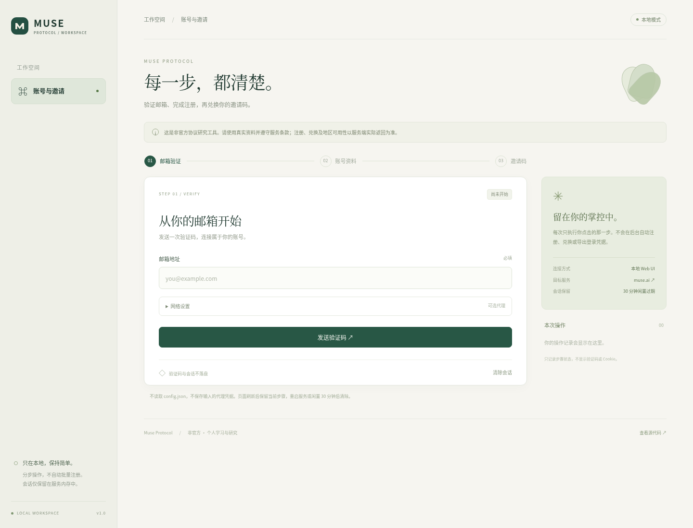

# muse.ai 注册 / 邀请码兑换 协议分析

补充一下，记得用JP 节点， JP 不需要绑卡，直接过

纯 HTTP 实现 muse.ai 的注册与邀请码兑换流程，不依赖浏览器。本文记录的是通过抓包逐字段比对得出的协议细节。

## 快速开始

```bash
pip install -r requirements.txt
cp config.example.json config.json   # 填入邮箱与可选代理
python example_register.py
```

## Web UI（新增）

现在可以用中文浏览器操作台逐步完成邮箱验证、注册资料、激活与邀请码兑换。无需前端构建，原命令行示例保持可用。

```bash
python -m pip install -r requirements-web.txt
python webui.py
```

在同一台电脑打开 **http://127.0.0.1:7860**。此地址不是公网访问链接，服务只监听本机；Web UI 不读取示例 `config.json`，请在页面中填写真实资料。



[完整安装、操作与安全说明](docs/WEBUI.md) · [移动视口截图](docs/webui-mobile.png)

界面和交互已用离线模拟客户端验证，未实测真实注册或兑换，不代表服务端流程始终可用。

## 目录结构

```
musepy/
  client.py    注册 + 兑换的完整协议客户端
  falco.py     行为埋点上报（可选）
  caa.py       注册漏斗事件上报（可选）
example_register.py   原有命令行端到端示例
webui.py              本地 Flask + Waitress Web UI
web/                  HTML、CSS、JS（无需构建）
tests/                离线与浏览器交互检查
requirements-web.txt  Web UI 依赖
config.example.json   命令行配置模板
```

## 协议流程

```
GET  /                                   拿初始 cookie
POST /api/auth/native/restart            → 201 {csrf_token}
POST /api/auth/native/send-otp           → 201
POST /api/auth/native/confirm-otp        → 200 {registration_state:"completion_required"}
POST /api/auth/native/register-completion→ 200 {auth_meta_session:{frl_access_token, frl_account_id}}
POST /api/hatch/accept-tos               → 200（激活会话，必须）
GET  /api/hatch/invite                   → 200 表示账号有效
POST /api/hatch/vm/wake                  → 200（必须，否则兑换误报 invalid）
POST /api/hatch/stateful-sharing         → 200
POST /api/hatch/invite-code/redeem       → 200 {redemptionStatus:"redeemed"}
POST /api/hatch/invite                   → 200 {code}（刮出自己的码）
```

## 几个容易踩的坑

### 1. `confirm-otp` 必须带 `supports_muse_link_transparency: true`

```json
{"otp_code":"123456","remember_device":true,"supports_muse_link_transparency":true}
```

### 2. `register-completion` 的姓名字段语义

```json
{
  "date_of_birth": "1993-11-14",
  "first_name": "三郎",     // 名（given name）
  "last_name": "近藤",      // 姓（family name）
  "tos_content_version": "ntm_create_account:default_v1_meta_account_v3+docs_v2",
  "remember_device": true
}
```

`first_name` 是名、`last_name` 是姓，与直觉相反。生日早于约 18 年前会返回 403——同一会话同一份姓名，只把生日从 2013 改成 1993 就能从 403 变 200。

### 3. `restart` 的 body 不是空对象

```json
{"resume": false}
```

### 4. `accept-tos` 是会话激活开关

注册完成后 `GET /api/hatch/invite` 会是 403。必须先调 `accept-tos`，且 `disclosure_text` 要填完整日文文案（不是随便一个字符串），之后 invite 才返回 200。

### 5. `vm/wake` 缺失会让兑换误报

不调 `vm/wake` 直接兑换，即使是有效码也会返回：

```json
{"success":false,"reason":"invalid","detail":"この招待コードは存在しません"}
```

需要先从已登录页面提取 `vmId`：

```python
re.search(r'vmId[\\"]*:[\\"]*([0-9a-fA-F-]{36})', html)
```

### 6. 兑换失败原因的含义

| reason | 含义 |
|---|---|
| `redeemed` | 成功 |
| `already_redeemed` | 本账号已经兑换过一个码 |
| `used_up` | 该码达到 30 次使用上限 |
| `invalid` | 码不存在，或没调 `vm/wake` |

## Cookie

注册成功后 `hatch_sess` 由 `register-completion` 的响应头下发（约 886 字符），这是后续所有 hatch 接口的凭证。`hatch_vml` 在注册阶段一直是被清空状态（`Max-Age=0`），不属于必需项。

## 埋点说明

站点前端会上报两类遥测：

- **falco**（`POST /api/falco`）—— 性能指标与业务交互事件，`machineId` 固定为 `not_set`
- **caa-events**（`POST /api/auth/caa-events`）—— 注册漏斗，通过 `navigator.sendBeacon` 逐步骤上报，同一 `waterfall_id` 贯穿全程

两者都不参与注册判定，缺省不影响流程能跑通。`musepy/falco.py` 与 `musepy/caa.py` 保留了完整实现，可通过配置关闭。

## 使用声明

本项目仅供个人、非商业的学习与研究使用，不采用 MIT 等开源许可证。不得用于商业用途或再分发。实际使用时请遵守目标站点的服务条款与当地法律法规。

交流群 t.me/muihbb
