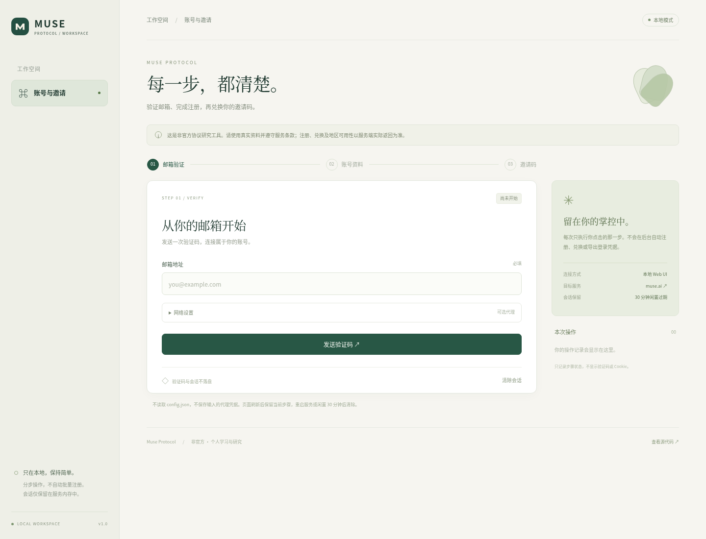
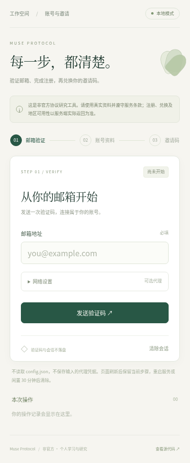

# 本地 Web UI

给现有的 Python 协议客户端加一个中文操作台。浏览器只访问本地 Python 服务，由服务调用 `MuseClient`，不是嵌入或仿造 Muse 官方网页。



上图是 Chromium 中的实际本地页面渲染，不是设计稿。截图及交互测试使用离线模拟客户端，没有发送真实验证码、注册账号或兑换邀请码。

## 安装与启动

要求 Python 3.10+。使用独立虚拟环境，不需要 Node.js 或前端编译。

macOS / Linux：

```bash
git clone https://github.com/lucaisgrowing/muse-protocol.git
cd muse-protocol
python3 -m venv .venv
. .venv/bin/activate
python -m pip install -r requirements-web.txt
python webui.py
```

Windows PowerShell：

```powershell
git clone https://github.com/lucaisgrowing/muse-protocol.git
cd muse-protocol
py -m venv .venv
.\.venv\Scripts\python.exe -m pip install -r requirements-web.txt
.\.venv\Scripts\python.exe webui.py
```

在运行上述命令的同一台电脑上，用浏览器打开 **http://127.0.0.1:7860**。命令窗口需要保持开启，按 Ctrl+C 停止服务。端口冲突时运行 `python webui.py --port 7861`，并打开相应地址。

这不是托管在线服务。云电脑上的 `127.0.0.1` 不会自动变成手机或另一台电脑可打开的链接。若在自己有 SSH 权限的服务器上运行，可用 SSH 本地端口转发；不要把此单用户工具直接公开到公网。

## 操作流程

1. 填写邮箱。网络设置中的代理可选，默认直连；不会读取 `config.json` 中的示例身份或代理。
2. 点击「发送验证码」，查看自己的邮箱，再输入 6 位验证码。60 秒内禁止重复发送；重发使用同一客户端与同一收件邮箱。
3. 新账号填写本人的姓名、真实生日并提交；如果协议返回已登录现有账号且权限检查通过，则跳过注册资料。
4. 接受目标服务条款并激活会话。程序沿用现有客户端的条款文案与协议版本，不是条款内容的实时副本；操作前应自行到官网阅读现行条款。
5. 准备兑换会话：取得 VM 标识、请求唤醒并进行原客户端要求的状态共享。页面不会把「请求已接收」当作 VM 已真正运行。
6. 手动输入邀请码并兑换。服务端确认成功后，可再点击「获取我的邀请码」并复制。

每个步骤都由按钮明确触发，无自动批量任务，不会自动重试注册和兑换。已知兑换失败会解释原因；结果不明时暂停流程，先到官网确认，避免重复提交。清除会话只断开本地连接，不删除官方账号、不撤销兑换。

不填写随机生日，也不自动改变代理地区来绕过服务限制。服务可用性、年龄要求、验证码、VM 权限和兑换状态均由服务端决定。协议变更可能导致步骤失效。

## 数据与本地安全

- 服务仅监听 `127.0.0.1`，使用 Waitress，关闭调试器，不提供公网监听参数。
- Cookie 只含随机会话标识与 CSRF 令牌，使用 HttpOnly / SameSite=Strict。协议 Cookie、代理凭据留在 Python 内存中，不返回浏览器。
- 验证码不写日志、不存配置；浏览器校验成功后清空验证码输入。原始服务端响应和异常不会直接回显，避免泄露 Cookie 或代理密码。
- 本地 session 闲置超过 30 分钟后再次访问即失效并清理；重启服务也会丢失会话。清除按钮立即关闭当前协议客户端。刷新页面会恢复步骤和邮箱，不恢复生日或代理输入。
- 内置 CSRF、防跨站请求、Host 校验、CSP、禁止 iframe 与不缓存响应。界面不用 CDN、远程字体、前端统计或第三方脚本。
- 最多保留 64 个本地浏览器会话；并发按钮请求加锁。没有多用户登录、数据库或凭据导出，不是经过独立安全审计的公网产品。
- `.gitignore` 排除 `config.json`、`.env`、虚拟环境及日志；不要将自己的配置、Cookie 或验证码提交到仓库。

## 验证范围

已通过 Python 编译、41 项离线自动化测试以及 Chromium 桌面/390px 移动视口交互检查。浏览器检查覆盖模拟的邮箱验证、注册、激活、唤醒、兑换、邀请码获取、刷新恢复和清除流程，未发现 JS 错误或横向溢出。

未做真实账号注册/兑换、iPhone/Safari 真机或正式生产安全验证。截图中的流程页面是实际运行的 UI；外部服务结果只在测试中模拟。

```bash
python -m unittest discover -s tests -v
```

可选浏览器检查（会启动临时本地服务器，所有外部协议请求均替换为 FakeClient）：

```bash
python -m pip install -r requirements-dev.txt
python -m playwright install chromium
python tests/browser_smoke.py
```

该脚本会更新 `docs/webui-desktop.png`、`docs/webui-mobile.png`。如复用已安装的 Chromium，可用 `PLAYWRIGHT_CHROMIUM_EXECUTABLE` 指定其可执行路径。GitHub Actions 运行离线 Python 测试与 JS 语法检查，不运行真实服务请求。

<details>
<summary>移动视口截图（Chromium，非手机实机）</summary>



</details>
